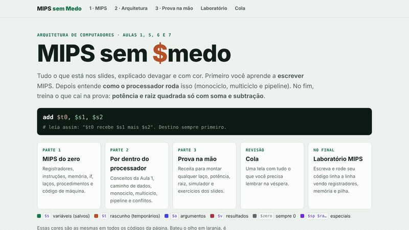

# MIPS sem Medo

Material de estudo interativo de **Arquitetura de Computadores**, em uma única página HTML. Resume as aulas sobre MIPS, caminho de dados (monociclo, multiciclo e pipeline) e treina as questões clássicas de prova: **potência e raiz quadrada usando só soma e subtração**.


## O que tem na página

| Parte | Conteúdo |
|---|---|
| **1 · MIPS do zero** | Registradores, instruções, memória, `if`, laços, procedimentos e código de máquina |
| **2 · Por dentro do processador** | Caminho de dados, monociclo, multiciclo, pipeline e conflitos (hazards) |
| **3 · Prova na mão** | Receita para montar qualquer laço, potência e raiz, com simulador e exercícios dos slides |
| **Cola** | Tudo o que precisa lembrar na véspera, numa tela só |
| **Laboratório MIPS** | Escreva e execute código MIPS linha a linha vendo registradores, memória e pilha |

Os registradores têm sempre a mesma cor em todos os exemplos (`$s` salvos, `$t` temporários, `$a` argumentos, `$v` resultados), o que facilita ler o código de relance.

## Demonstração



## Como usar

Não precisa instalar nada: baixe o repositório e abra o `index.html` no navegador.

```bash
git clone https://github.com/Pimenta15/mips-sem-medo.git
cd mips-sem-medo
# abra index.html no navegador
```

## Tecnologias

HTML, CSS e JavaScript puro, sem dependências ou build.

---

Feito por [João Pedro Pimenta](https://www.linkedin.com/in/joao-pedro-pimenta/) para estudar e ajudar a turma.
